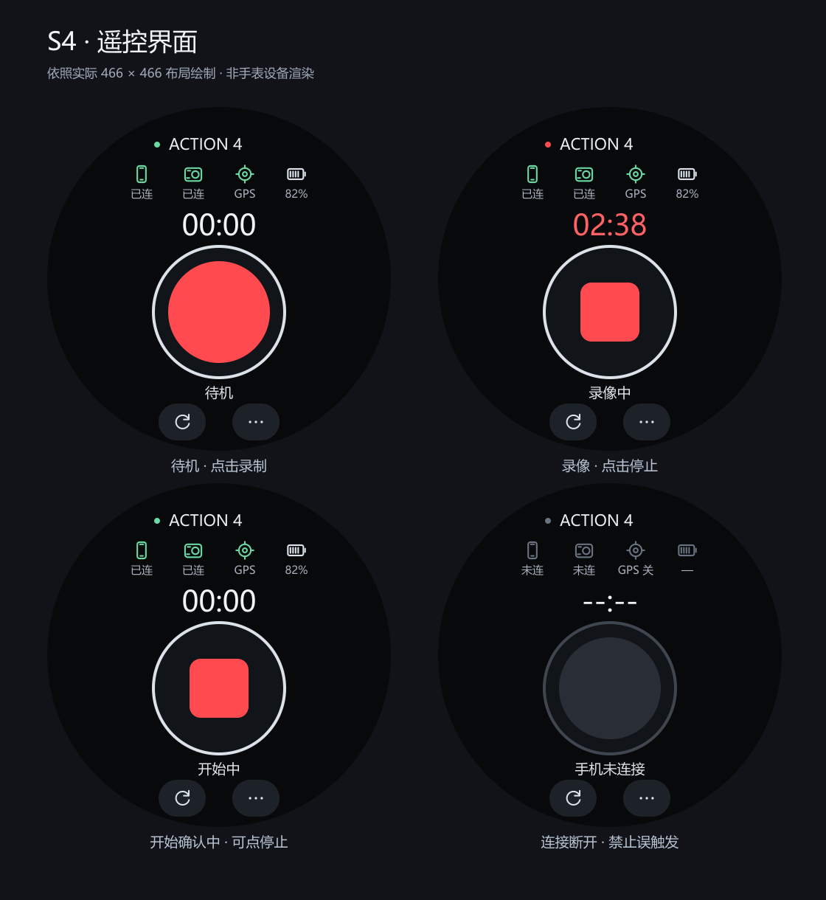
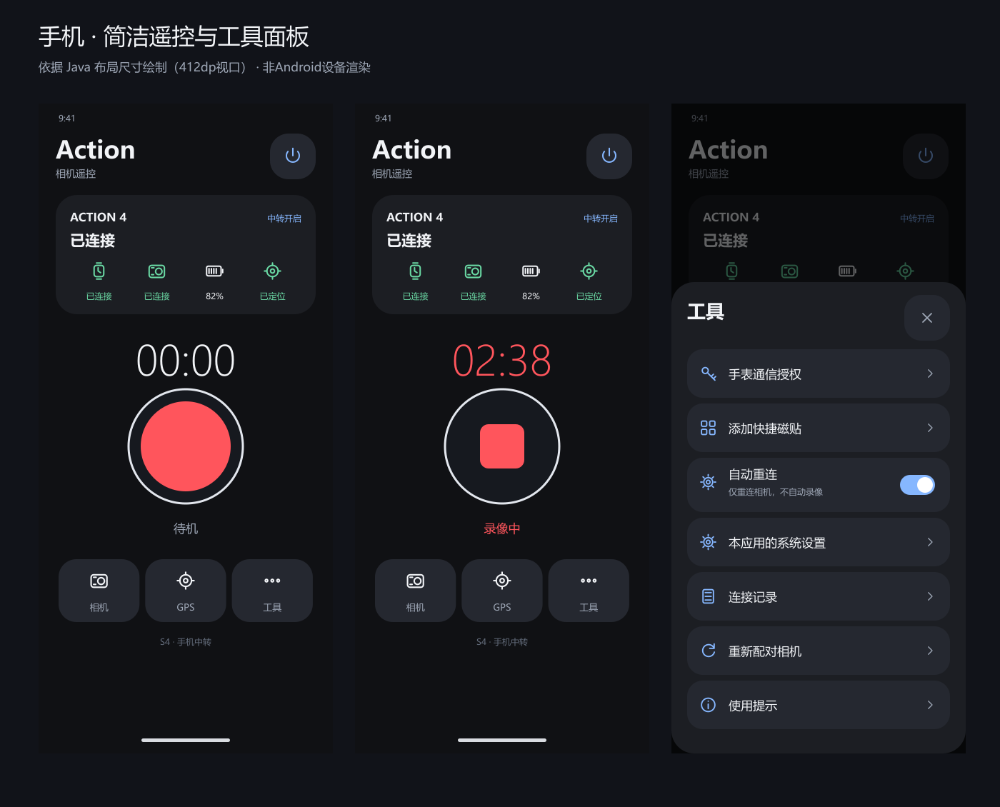

# Action Relay

国行 Xiaomi Watch S4 → 小米安卓手机 → DJI Osmo Action 4 的蓝牙录像遥控工具。

用户设备：S4 3.201.79；小米 17 / 澎湃 OS 4 / Android 17；Action 4。

`main` 与 `v0.2.0` 保存用户已实测基本可用的手机中转基线。已知停止录像回报延迟、状态偶发误显示，正在 `work/v0.3-watch-first` 优化。

## v0.3 进行中的工作

- 手表优先：参考 Osmo 自家遥控器的图形控制，192 px 主触控区、简短状态与图标。
- 停止确认：支持覆盖尚未确认的开始操作、等待状态稳定、处理迟到确认。
- 手机 GNSS：依据大疆官方 00/17 数据帧，发送真实且新鲜的完整定位；录像指令优先。
- 手机界面：原生 Java 实现 miuix 风格卡片与图形控件，尚未迁移到 Compose / Miuix 库。
- 相机记忆、安全重连、Android 快捷设置磁贴。

当前开发分支包含已完成并单测的模块及新界面，**集成和整包编译尚待完成，不能视为新版本已可用**。后续由 VS Code Copilot 接手，任务见 [COPILOT_HANDOFF.md](COPILOT_HANDOFF.md)。

## 界面方向

以下按布局绘制，用于讨论视觉方向；不是设备渲染或运行证明。

## 工程与协作

- `android/src`：原生手机应用，含 BLE、中转、协议、GNSS 模块。
- `watch/src`：Vela 快应用，仅用 `system.interconnect` 与手机通信。
- `scripts/build-local.ps1`：在本机定位 SDK / JDK / Vela 工具链并构建。
- `scripts/test.ps1`：协议、队列、GPS、手表回归检查。
- [AGENTS.md](AGENTS.md)：Codex 与 Copilot 共用的项目约定。
- [COPILOT_HANDOFF.md](COPILOT_HANDOFF.md)：目前未完成的任务、边界与验收方式。

两端包名和证书必须一致。签名私钥、本机配置、位置轨迹及个人日志不进 Git；源码内保留第三方说明。新版本必须通过实机拍摄、保存后状态、锁屏和 GPS 视频数据验证。
